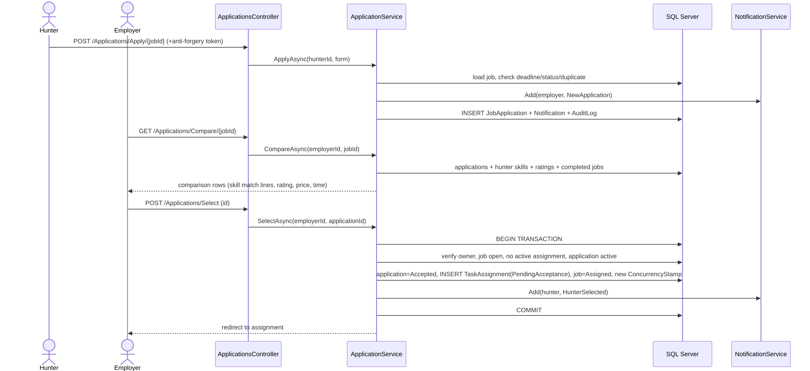
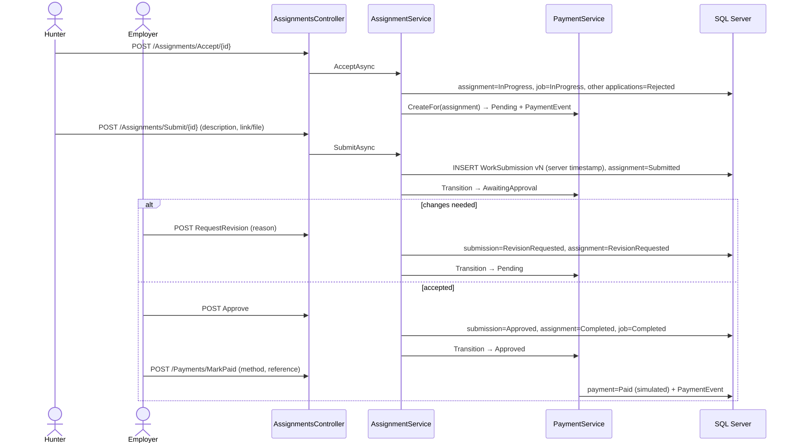
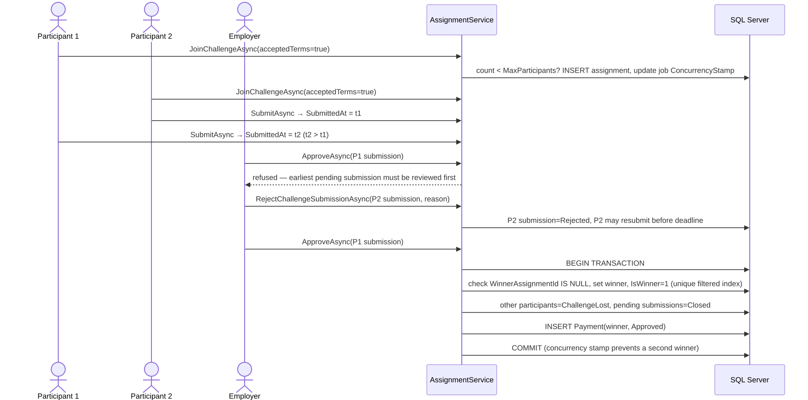

# UML and Design Diagrams — SkillBridge

All diagrams are Mermaid sources (`diagrams/*.mmd`) rendered to SVG. They reflect the implemented system.

| # | Diagram | Source | Image |
|---|---|---|---|
| 1 | Use-case diagram | [01-use-case.mmd](diagrams/01-use-case.mmd) |  |
| 2 | System architecture | [02-architecture.mmd](diagrams/02-architecture.mmd) |  |
| 3 | ER / database relationship diagram | [03-er.mmd](diagrams/03-er.mmd) |  |
| 4 | Class diagram (services & rules) | [04-class.mmd](diagrams/04-class.mmd) |  |
| 5 | Activity diagram — main workflow (incl. challenge) | [05-activity-main-workflow.mmd](diagrams/05-activity-main-workflow.mmd) |  |
| 6 | Sequence — application and Hunter selection | [06-sequence-apply-select.mmd](diagrams/06-sequence-apply-select.mmd) |  |
| 7 | Sequence — work submission and approval | [07-sequence-submit-approve.mmd](diagrams/07-sequence-submit-approve.mmd) |  |
| 8 | Sequence — challenge first-valid-submission | [08-sequence-challenge.mmd](diagrams/08-sequence-challenge.mmd) |  |
